<p align="center">
  <picture>
    <source media="(prefers-color-scheme: dark)" srcset="assets/wordmark-dark.png">
    
  </picture>
</p>

<p align="center"><b>A strategy firm for your AI agent. No retainer.</b><br>Including the partner who sends your deck back.</p>

<p align="center">
  
</p>

## How it works

You tell your agent that growth has stalled. It does not reach for a SWOT.

It asks who decides, by when, and what number would count as success. Then it writes down the answer it would give if the project ended today, and spends the rest of the time trying to prove itself wrong. Every hypothesis gets a kill criterion before any data arrives. Every number gets a source, or it gets called what it is: an assumption.

When there is something to show, it builds the model so your CFO can check it in five minutes, and the deck so your board can read just the titles and still get the story.

Then the partner reads it. The partner has seen a thousand decks and is not impressed by yours. Expect "so what?", expect numbers that don't tie, expect the premortem. If it survives, it ships.

## See it work

We gave the partner a weak board summary from a fictional bakery chain and asked: *"Is it ready?"*

> **The draft:** Corporate catering can add EUR 9m in revenue by 2031 [...] We recommend exploring the catering opportunity further and considering an accelerated online roadmap.

> **The partner:** Verdict: **Return.** The numbers in the recommendation don't tie to the document's own table, and the recommendation itself ("exploring," "considering") isn't a fundable decision.

Four more findings followed, a premortem, and a rewrite of what a fundable summary would say. It also caught something we had not planted: read correctly, the plan falls EUR 4.1m short of its own target, and the draft never says so.

The full run is in [`evals/results/partner-review/`](evals/results/partner-review/).

## The firm

| | | |
|:---:|---|---|
|  | **[strategy-engagement](skills/strategy-engagement)** | Turns a vague briefing into a sharp question, a first answer and a plan to test it. Then does the research. |
|  | **[strategy-deliverables](skills/strategy-deliverables)** | The model and the deck. Excel with live formulas, slides in HTML and PPTX, or a one-page memo. |
|  | **[partner-review](skills/partner-review)** | Reads anything before it leaves the building. Returns it, or lets it go with fixes. |

Six playbooks come with it: growth, market entry, turnaround, pricing, M&A and operating model.

<p>
  &nbsp;
  &nbsp;
  &nbsp;
  &nbsp;
  &nbsp;
  
</p>

## Install

```bash
npx skills add aipiratesMunich/open-strategy-firm
```

The skills follow the open [Agent Skills](https://agentskills.io) format and run in Claude Code, Codex, Cursor, Gemini CLI, GitHub Copilot, OpenCode and other agents that load skills. You can also copy the folders from [`skills/`](skills/) into your agent's skills directory.

Then talk to it like you would to a partner:

- *"We're a 60-million bakery chain and growth has stalled. What should we do?"*
- *"Give me a day-one answer on entering the Polish market."*
- *"Partner review this deck before the board sees it."*
- *"Check this Excel model before the CFO does."*

For one-liners like "good idea?", agents sometimes answer without loading a skill. Name it to be sure: *"Use strategy-engagement: we charge 89 a month and think of 109. Good idea?"*

It works without web access too: it asks you for the data and marks what it could not check.

## What it believes

- **The question comes before the analysis.** Most wasted work starts with a vague question.
- **Answer first, then try to kill it.** A first answer on day one, tested from then on.
- **A number without a source is an assumption.** And it says so.
- **Nothing leaves without the partner.** A review that only praises is not a review.

## Does it hold up?

Every skill is tested on realistic cases: weak drafts with planted mistakes, traps it has to refuse, messy one-line briefings. Each case runs in Claude Code with only that skill installed, and a separate run grades the result against written criteria.

| Skill | Cases | Runs | Runs passing every criterion | Criteria met |
|---|---|---|---|---|
| partner-review | 4 | 10 | 9 | 83 of 84 (99%) |
| strategy-engagement | 24 | 72 | 29 | 632 of 708 (89%) |
| strategy-deliverables | 6 | 18 | 7 | 155 of 177 (88%) |

Final runs on 14 October 2026 (partner-review: 15 October, v0.2.0): every case two or three times, the good-memo case four times, Claude Code with Sonnet, graded by a separate Sonnet run. A run fails if a single criterion is missed, so "criteria met" is the fairer quality measure. Some misses come from the agent answering without loading the skill; naming the skill avoids that.

partner-review v0.2.0 responds to community feedback. A reviewer reported a deck whose numbers did not foot across slides coming back as Release with a soft "consider reconciling". We could not reproduce that with Sonnet: on our new test deck the previous version also returned it. The rule is now explicit anyway: a figure the draft states twice with different values is a Blocker and forces Return, and fixes are written as instructions. The premortem must now name at least one internal cause (owner, incentives, capacity, structure, politics); the new version did so in both runs, the previous version in one of two. The good-memo case taught us something too. Both versions returned our "good" memo in 3 of 4 runs, and the reviewer was right: the memo justified its second recommendation with a reason its own evidence contradicted. We fixed the memo, not the reviewer. On the corrected memo the new version released it with fixes in 4 of 4 runs. The earlier runs on the flawed memo are published as well. All of these runs are in `evals/results/partner-review/`.

All cases and every graded run of the final evaluation, including the failures, are in [`evals/`](evals/).

## Built by

People who have run agencies and worked alongside strategy consultants on client projects for years. Published by [AI Pirates](https://ai-pirates.com). All examples use fictional companies and invented figures.

These skills structure thinking, test evidence and catch what a demanding reviewer would catch. They do not replace legal, tax, audit or technical due diligence, and they will tell you when you need one.

## License

[MIT](LICENSE)
